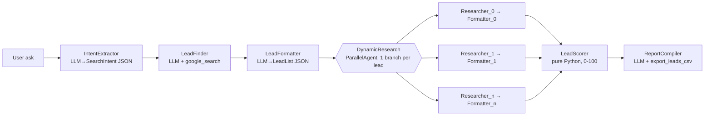

# (a) Deep-Research Lead Generation Agent

Free-text ask ("find 5 fintech companies in the US that need fraud tooling") → ranked, evidence-backed lead report + CSV.



## Code map
| File | What it does |
|---|---|
| `lead_gen_agent/pipeline.py` | The whole graph. `DynamicResearchAgent` builds the parallel fan-out at runtime (lead count unknown until the Finder runs). `build_lead_gen_agent()` is a factory so models/search tool are injectable. |
| `lead_gen_agent/schemas.py` | Pydantic contracts between stages (`SearchIntent`, `LeadList`, `LeadResearch`). |
| `lead_gen_agent/tools.py` | Deterministic `score_lead` (signal weights, sources required, capped) and `export_leads_csv` (path-traversal safe). |
| `lead_gen_agent/prompts.py` | All prompts in one place. |

## Design decisions worth explaining in the video
1. **Search agent ≠ formatter agent.** Gemini's built-in `google_search` can't be combined with `output_schema` on one agent, so a searcher emits text and a tool-less formatter validates it into JSON.
2. **Scoring is code, not vibes.** Signals without a source URL are ignored → the LLM can't inflate a score by hallucinating news. Same input = same score; unit-tested.
3. **Fan-out per lead** with `ParallelAgent` gives wall-clock speed-ups; results land in state as `lead_research_<i>`.
4. State templating (`{intent}`, `{leads}`) passes data between agents without re-prompting.

## Run
```bash
python -m venv .venv && source .venv/bin/activate && pip install -r requirements.txt
cp .env.example .env   # add GOOGLE_API_KEY
adk web                # open http://localhost:8000, pick lead_gen_agent
# try: "Find 5 mid-size logistics companies in Germany hiring for data engineers; I sell a data-pipeline platform"
```
Offline proof (no key needed): `python -m pytest . -q` — runs the entire pipeline with a scripted model.

## Deploy
`PROJECT=my-proj ./deploy.sh` (Cloud Run, authenticated-only).
