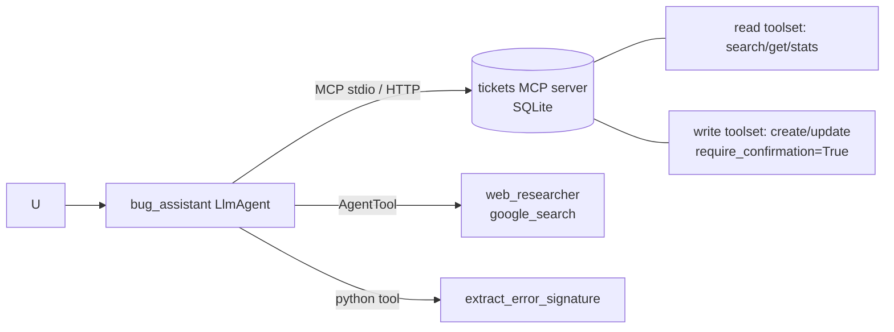

# (c) MCP-tools bug assistant

Triages bug reports: dedupes against the ticket tracker, researches causes on the web, files/updates tickets **only after a human approves**.



## Highlights
- **Real MCP**: `bug_assistant/mcp_servers/tickets_server.py` is a standalone FastMCP server (usable from Claude Desktop / Gemini CLI too). ADK's `McpToolset` spawns it over stdio, or connects to `MCP_TICKETS_URL` (streamable HTTP) in production.
- **Least privilege**: two toolsets with allow-lists; the write one uses ADK's tool confirmation, so the run *pauses* until a human approves (approve → row created; reject → nothing written — both tested).
- **Server-side validation** (severity/status vocab, parameterised SQL) independent of the model.

## Run
```bash
pip install -r requirements.txt && cp .env.example .env && export PYTHONPATH=$PWD
adk web      # try: "Users get HTTP 500 on /login after password reset: KeyError 'session_token' auth/session.py:88"
python -m bug_assistant.mcp_servers.tickets_server --http 8000   # run the MCP server on its own
```
Offline proof: `python -m pytest . -q` (spawns the real MCP server subprocess).
