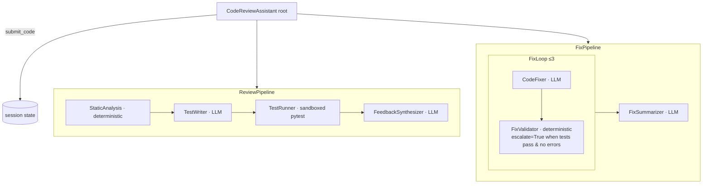

# (d) Production-quality Code Review Assistant

Paste Python → get a review backed by static analysis **and real test runs**, then optionally an auto-fix that is *proven* by tests.



## Production principles demonstrated
1. **LLM only where judgement is needed** (write tests, write review, write fix). Parsing, linting, test execution, loop-exit decision = deterministic code → cheaper, faster, testable.
2. **Evidence-grounded feedback**: the synthesizer only sees analysis + real test output.
3. **Closed-loop fixing**: the loop exits when the *validator* says so, not when the model feels done; max 3 attempts. (The e2e test shows attempt 1 rejected, attempt 2 accepted.)
4. **Sandbox** (`sandbox.py`): temp dir, scrubbed env (no secrets), `python -I`, CPU/memory rlimits, timeout, truncated output. *Threat model*: not a hard boundary — deploy in a locked-down container with no egress.
5. Input size caps, state reset per submission, fenced-code stripping, structured logging.

Detects: mutable defaults, bare/swallowed except, `eval/exec`, shell & SQL injection patterns, hard-coded secrets, complexity/nesting, naming/style.

## Run
```bash
pip install -r requirements.txt && cp .env.example .env && export PYTHONPATH=$PWD
adk web     # paste a function with a bug, then say "fix it"
```
Offline proof: `python -m pytest . -q` (10 tests incl. real pytest-in-sandbox, timeout kill, env-secret isolation, full review→fix flow).
