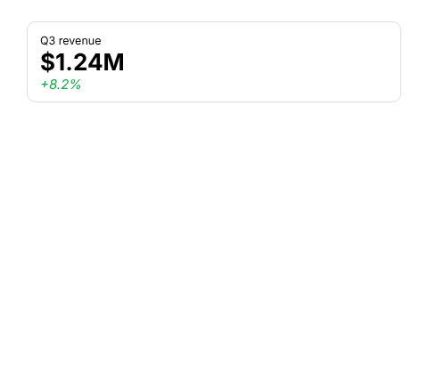
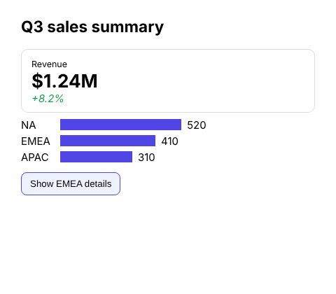
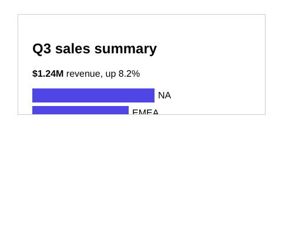
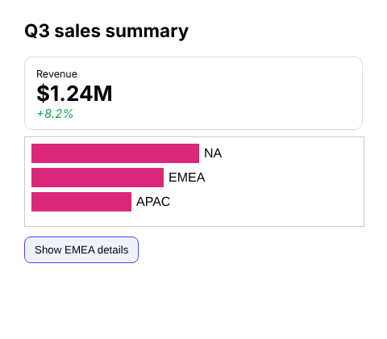

# Part 1 - A2UI

Reference: <https://a2ui.org/>

## The idea

A2UI (Agent-to-UI) is a declarative format. The agent sends **messages**: `surfaceUpdate` (a flat list of components), `dataModelUpdate` (data) and `beginRendering`. Structure and data travel separately, so data can change without resending layout.

All demos use the same scenario (a Q3 sales summary) and a **scripted model**, so they run offline and deterministically. Everything after the model call (parse, validate, render) is real and unchanged if you swap in a live model.

## Shared helpers for this part

- `wire.py` - envelopes, `Surface` (client state), `{path}` binding resolution

## Static mode

*The app owns the UI. The model selects a pre-built component and supplies values.*

**What this part shows:** Structure is app code; the model may only send `dataModelUpdate`.

### Code walkthrough - `part1_a2ui/static_mode.py`

```python
"""A2UI x STATIC. The app owns the layout; the agent only streams DATA.

The surface (structure) is hard-coded in the app and sent once. The model's reply is just a
dataModelUpdate. Nothing the model says can change what components exist.
Run: python part1_a2ui/static_mode.py
"""
import sys, pathlib; sys.path.insert(0, str(pathlib.Path(__file__).resolve().parents[1]))
from common.catalog import CATALOG
from common.fixtures import SALES
from common.llm import ScriptedLLM
from common.render import render_text, save_page
from common.ui import banner, step, show
from part1_a2ui.wire import Surface, encode_jsonl

banner("A2UI / STATIC: fixed surface, model supplies data only")

step(1, "App-owned surface. Written by a developer, never by the model.")
APP_SURFACE = [
    {"surfaceUpdate": {"surfaceId": "kpi", "components": [
        {"id": "card", "component": {"Metric": {"label": "Q3 revenue", "value": {"path": "/value"}, "delta": {"path": "/delta"}}}}]}},
    {"beginRendering": {"surfaceId": "kpi", "root": "card"}},
]
show("app messages", encode_jsonl(APP_SURFACE))

step(2, "The 'model' replies with data only (a dataModelUpdate).")
llm = ScriptedLLM([{"dataModelUpdate": {"surfaceId": "kpi", "contents": {"value": SALES["revenue"], "delta": SALES["growth"]}}}])
reply = __import__("json").loads(llm.next())
show("model reply", reply)

step(3, "Client applies app messages, then the model's data. Render.")
s = Surface()
for m in APP_SURFACE + [reply]:
    s.apply(m, CATALOG)
spec = s.resolve(CATALOG)
print(render_text(spec))
save_page(spec, "out/part1_static.html")

step(4, "Prove the boundary: the app only accepts dataModelUpdate from the model.")
def accept_from_model(msg):
    kind = next(iter(msg))
    if kind != "dataModelUpdate":
        raise PermissionError(f"static mode: model may not send '{kind}'")
    return msg
for attempt in (reply, {"surfaceUpdate": {"surfaceId": "kpi", "components": []}}):
    try: accept_from_model(attempt); print("accepted:", next(iter(attempt)))
    except PermissionError as e: print("REJECTED:", e)
```

### Run it

```bash
python part1_a2ui/static_mode.py
```

### Real output (captured by `run_all.sh`)

```text

======================================================================
A2UI / STATIC: fixed surface, model supplies data only
======================================================================

--- step 1: App-owned surface. Written by a developer, never by the model.
app messages:
    {"surfaceUpdate": {"surfaceId": "kpi", "components": [{"id": "card", "component": {"Metric": {"label": "Q3 revenue", "value": {"path": "/value"}, "delta": {"path": "/delta"}}}}]}}
    {"beginRendering": {"surfaceId": "kpi", "root": "card"}}

--- step 2: The 'model' replies with data only (a dataModelUpdate).
model reply:
    {
      "dataModelUpdate": {
        "surfaceId": "kpi",
        "contents": {
          "value": "$1.24M",
          "delta": "+8.2%"
        }
      }
    }

--- step 3: Client applies app messages, then the model's data. Render.
[ Q3 revenue: $1.24M (+8.2%) ]

--- step 4: Prove the boundary: the app only accepts dataModelUpdate from the model.
accepted: dataModelUpdate
REJECTED: static mode: model may not send 'surfaceUpdate'
```



## Declarative mode

*The model describes the UI from a catalog of allowed components. The app validates, then renders.*

**What this part shows:** Model emits JSONL; a wrong component name becomes an error the model can fix; a data-only update changes one bar.

### Code walkthrough - `part1_a2ui/declarative_mode.py`

```python
"""A2UI x DECLARATIVE. The model emits the whole surface as JSONL messages from a catalog.

Includes a correction loop: invalid output becomes a tool-result-style error, the model retries.
Then a data-only update shows structure and data are separate streams.
Run: python part1_a2ui/declarative_mode.py
"""
import sys, pathlib, json; sys.path.insert(0, str(pathlib.Path(__file__).resolve().parents[1]))
from common.catalog import CATALOG, catalog_prompt, ValidationError
from common.fixtures import DECL_SPEC, BAD_SPEC
from common.llm import ScriptedLLM
from common.render import render_text, save_page
from common.ui import banner, step, show
from part1_a2ui.wire import Surface, spec_to_messages, encode_jsonl, parse_jsonl

banner("A2UI / DECLARATIVE: model describes the surface, app validates and renders")

step(1, "The system prompt is generated from the catalog.")
print(catalog_prompt(CATALOG))

step(2, "Model attempt 1 uses a component that does not exist (Gauge).")
llm = ScriptedLLM([encode_jsonl(spec_to_messages(BAD_SPEC)), encode_jsonl(spec_to_messages(DECL_SPEC))])
surface, error = Surface(), None
for attempt in (1, 2):
    surface = Surface()
    text = llm.next(error or "Give me a Q3 sales summary")
    try:
        for m in parse_jsonl(text):
            surface.apply(m, CATALOG)
        spec = surface.resolve(CATALOG)
        print(f"attempt {attempt}: valid")
        break
    except ValidationError as e:
        error = str(e)
        print(f"attempt {attempt}: INVALID -> fed back to model as an error:\n    {error}")

step(3, "Valid surface streamed as JSONL (note: 3 messages, structure and data apart).")
show("wire", encode_jsonl(spec_to_messages(DECL_SPEC)))

step(4, "Render the same surface to terminal and HTML.")
print(render_text(spec)); save_page(spec, "out/part1_declarative.html")

step(5, "Data-only update: APAC grows. No layout is resent.")
surface.apply({"dataModelUpdate": {"surfaceId": "main", "contents": {"regions": {"NA": 520, "EMEA": 410, "APAC": 455}}}}, CATALOG)
print(render_text(surface.resolve(CATALOG)))
```

### Run it

```bash
python part1_a2ui/declarative_mode.py
```

### Real output (captured by `run_all.sh`)

```text

======================================================================
A2UI / DECLARATIVE: model describes the surface, app validates and renders
======================================================================

--- step 1: The system prompt is generated from the catalog.
You may only use these components:
- Stack(none) +children: Vertical container.
- Heading(text:str): A section title.
- Metric(label:str, value:str, delta:str): One KPI with change.
- BarChart(data:dict): Bars from {label: number}.
- Button(label:str, action:str): Sends a NAMED action to the app.

--- step 2: Model attempt 1 uses a component that does not exist (Gauge).
attempt 1: INVALID -> fed back to model as an error:
    kpi: unknown component 'Gauge'. Allowed: ['BarChart', 'Button', 'Heading', 'Metric', 'Stack']
attempt 2: valid

--- step 3: Valid surface streamed as JSONL (note: 3 messages, structure and data apart).
wire:
    {"surfaceUpdate": {"surfaceId": "main", "components": [{"id": "page", "component": {"Stack": {"children": {"explicitList": ["title", "kpi", "chart", "more"]}}}}, {"id": "title", "component": {"Heading": {"text": "Q3 sales summary"}}}, {"id": "kpi", "component": {"Metric": {"label": "Revenue", "value": "$1.24M", "delta": "+8.2%"}}}, {"id": "chart", "component": {"BarChart": {"data": {"path": "/regions"}}}}, {"id": "more", "component": {"Button": {"label": "Show EMEA details", "action": "show_region:EMEA"}}}]}}
    {"dataModelUpdate": {"surfaceId": "main", "contents": {"regions": {"NA": 520, "EMEA": 410, "APAC": 310}}}}
    {"beginRendering": {"surfaceId": "main", "root": "page"}}

--- step 4: Render the same surface to terminal and HTML.
  # Q3 sales summary
  [ Revenue: $1.24M (+8.2%) ]
  NA   #################### 520
  EMEA ################ 410
  APAC ############ 310
  <Show EMEA details> -> action 'show_region:EMEA'

--- step 5: Data-only update: APAC grows. No layout is resent.
  # Q3 sales summary
  [ Revenue: $1.24M (+8.2%) ]
  NA   #################### 520
  EMEA ################ 410
  APAC ################## 455
  <Show EMEA details> -> action 'show_region:EMEA'
```



## Open-ended mode

*The model writes markup. Anything goes, so it is linted and isolated in a sandboxed iframe.*

**What this part shows:** A2UI is declarative by design. Open-ended output is a custom catalog component (`HtmlArtifact`) - a pattern built on A2UI, not a native mode.

### Code walkthrough - `part1_a2ui/open_ended_mode.py`

```python
"""A2UI x OPEN-ENDED. A2UI is declarative by design, so open-ended output needs a catalog entry that
hosts markup: here a custom 'HtmlArtifact' component. The whole surface is one sandboxed region.

Honest note: this is a pattern built ON A2UI (custom catalogs are part of the spec), not a built-in mode.
Run: python part1_a2ui/open_ended_mode.py
"""
import sys, pathlib; sys.path.insert(0, str(pathlib.Path(__file__).resolve().parents[1]))
from common.catalog import HYBRID_CATALOG
from common.fixtures import OPEN_HTML, HOSTILE_HTML
from common.render import render_text, save_page
from common.sandbox import lint_html, check_message
from common.ui import banner, step, show
from part1_a2ui.wire import Surface

banner("A2UI / OPEN-ENDED: one custom component carries model-written HTML")

def surface_for(html):
    return [{"surfaceUpdate": {"surfaceId": "free", "components": [
                {"id": "art", "component": {"HtmlArtifact": {"html": html, "height": 170}}}]}},
            {"beginRendering": {"surfaceId": "free", "root": "art"}}]

n = 0
for name, markup in (("friendly reply", OPEN_HTML), ("hostile reply", HOSTILE_HTML)):
    n += 1; step(n, f"Model returns HTML ({name}). Lint first.")
    findings = lint_html(markup)
    print("lint findings:", findings or "none")
    if findings:
        print("-> BLOCKED: not rendered. Findings are returned to the model as an error.")
        continue
    s = Surface()
    for m in surface_for(markup): s.apply(m, HYBRID_CATALOG)
    spec = s.resolve(HYBRID_CATALOG)
    print(render_text(spec)); save_page(spec, "out/part1_open_ended.html")
    n += 1; step(n, "Render inside sandbox. The only exit is postMessage; the host checks shape and action name.")
    print("allowed :", check_message({"type": "action", "name": "show_region", "arg": "EMEA"}))
    try: check_message({"type": "action", "name": "delete_everything"})
    except PermissionError as e: print("rejected:", e)
```

### Run it

```bash
python part1_a2ui/open_ended_mode.py
```

### Real output (captured by `run_all.sh`)

```text

======================================================================
A2UI / OPEN-ENDED: one custom component carries model-written HTML
======================================================================

--- step 1: Model returns HTML (friendly reply). Lint first.
lint findings: none
[sandboxed HTML, 549 chars]

--- step 2: Render inside sandbox. The only exit is postMessage; the host checks shape and action name.
allowed : {'type': 'action', 'name': 'show_region', 'arg': 'EMEA'}
rejected: action 'delete_everything' is not allowed

--- step 3: Model returns HTML (hostile reply). Lint first.
lint findings: ['external <script src>', 'network call', 'storage/cookie access', '<form> (can post data out)', 'external URL']
-> BLOCKED: not rendered. Findings are returned to the model as an error.
```



## Mixed mode

*Catalog components for the routine parts plus ONE sandboxed HtmlArtifact for a custom region.*

**What this part shows:** Same envelopes; one component is the escape hatch. Clicks are named actions the app authorizes.

### Code walkthrough - `part1_a2ui/mixed_mode.py`

```python
"""A2UI x MIXED. Catalog components for the routine parts, ONE HtmlArtifact for the custom region.

The report's recommended default: declarative everywhere, open-ended only where needed.
Run: python part1_a2ui/mixed_mode.py
"""
import sys, pathlib; sys.path.insert(0, str(pathlib.Path(__file__).resolve().parents[1]))
from common.catalog import HYBRID_CATALOG
from common.fixtures import MIXED_SPEC
from common.render import render_text, save_page
from common.sandbox import check_message
from common.ui import banner, step, show
from part1_a2ui.wire import Surface, spec_to_messages, encode_jsonl

banner("A2UI / MIXED: catalog components + one sandboxed custom region")

step(1, "Messages: same four envelopes, one component is the escape hatch.")
msgs = spec_to_messages(MIXED_SPEC, bind_chart=False)
show("components", [c["id"] + " -> " + next(iter(c["component"])) for c in msgs[0]["surfaceUpdate"]["components"]])

step(2, "Apply, resolve, render. Heading/Metric/Button are native; the chart is sandboxed.")
s = Surface()
for m in msgs: s.apply(m, HYBRID_CATALOG)
spec = s.resolve(HYBRID_CATALOG)
print(render_text(spec)); save_page(spec, "out/part1_mixed.html")

step(3, "Close the loop: a click becomes a NAMED action; the app decides if it is permitted.")
for action in ({"type": "action", "name": "show_region", "arg": "EMEA"},
               {"type": "action", "name": "export_customer_table", "arg": "all"}):
    try: print("OK     ", check_message(action))
    except PermissionError as e: print("DENIED ", e)
```

### Run it

```bash
python part1_a2ui/mixed_mode.py
```

### Real output (captured by `run_all.sh`)

```text

======================================================================
A2UI / MIXED: catalog components + one sandboxed custom region
======================================================================

--- step 1: Messages: same four envelopes, one component is the escape hatch.
components:
    [
      "page -> Stack",
      "title -> Heading",
      "kpi -> Metric",
      "chart -> HtmlArtifact",
      "more -> Button"
    ]

--- step 2: Apply, resolve, render. Heading/Metric/Button are native; the chart is sandboxed.
  # Q3 sales summary
  [ Revenue: $1.24M (+8.2%) ]
  [sandboxed HTML, 339 chars]
  <Show EMEA details> -> action 'show_region:EMEA'

--- step 3: Close the loop: a click becomes a NAMED action; the app decides if it is permitted.
OK      {'type': 'action', 'name': 'show_region', 'arg': 'EMEA'}
DENIED  action 'export_customer_table' is not allowed
```


