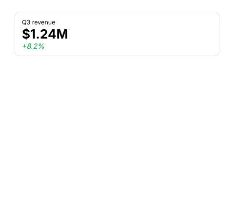
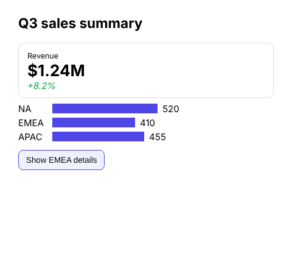
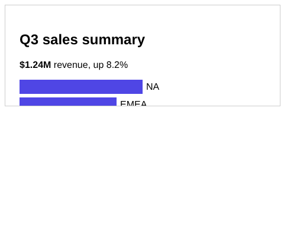
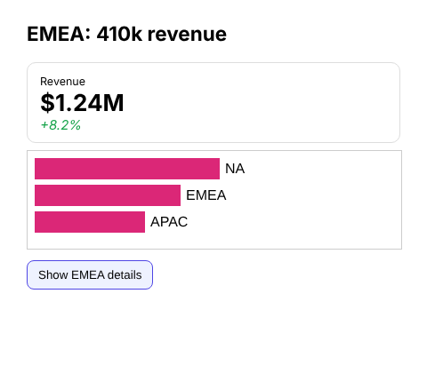

# Part 2 - AG-UI

Reference: <https://docs.ag-ui.com/>

## The idea

AG-UI is the **event protocol between agent and frontend**: `RUN_STARTED`, `TEXT_MESSAGE_*`, `TOOL_CALL_*`, `STATE_SNAPSHOT`, `STATE_DELTA` (JSON Patch), `RUN_FINISHED`, over SSE. It carries a UI; it does not define one.

All demos use the same scenario (a Q3 sales summary) and a **scripted model**, so they run offline and deterministically. Everything after the model call (parse, validate, render) is real and unchanged if you swap in a live model.

## Shared helpers for this part

- `events.py` - event constructors, SSE encode/decode, `RunAgentInput`

## Static mode

*The app owns the UI. The model selects a pre-built component and supplies values.*

**What this part shows:** Tool-call events pick a component from a frontend registry (tool-based generative UI).

### Code walkthrough - `part2_agui/static_mode.py`

```python
"""AG-UI x STATIC. Tool-call events drive pre-built components (the 'tool-based generative UI' pattern).

The agent streams TOOL_CALL events. The frontend has a registry {tool name -> component}.
The model selects; the frontend draws. Run: python part2_agui/static_mode.py
"""
import sys, pathlib, json; sys.path.insert(0, str(pathlib.Path(__file__).resolve().parents[1]))
from common.fixtures import STATIC_CALL
from common.llm import ScriptedLLM
from common.render import render_text, save_page
from common.ui import banner, step, show
from part2_agui.events import event, sse_encode, sse_decode, new_id, run_input

banner("AG-UI / STATIC: tool-call events -> fixed component registry")

def agent(inp):
    """The agent as a generator of events. Args are streamed in fragments, like model tokens."""
    run, call = inp["runId"], new_id("call")
    yield event("RUN_STARTED", threadId=inp["threadId"], runId=run)
    yield event("TOOL_CALL_START", toolCallId=call, toolCallName=STATIC_CALL["name"])
    for chunk in ScriptedLLM.stream(json.dumps(STATIC_CALL["arguments"]), 22):
        yield event("TOOL_CALL_ARGS", toolCallId=call, delta=chunk)
    yield event("TOOL_CALL_END", toolCallId=call)
    yield event("RUN_FINISHED", threadId=inp["threadId"], runId=run)

# Frontend registry: the ONLY things the agent can make appear.
REGISTRY = {"show_metric": lambda a: {"root": "m", "elements": {"m": {"type": "Metric", "props": a}}}}

step(1, "Frontend POSTs RunAgentInput; server answers with an SSE stream.")
inp = run_input(); show("RunAgentInput", inp)
wire = "".join(sse_encode(e) for e in agent(inp))
print("first 3 wire lines:"); [print("   ", l) for l in wire.split("\n\n")[:3]]

step(2, "Client decodes the stream and reacts to each event.")
args_buf = {}
for ev in sse_decode(wire):
    t = ev["type"]; extra = ev.get("delta") or ev.get("toolCallName") or ""
    print(f"  {t:<18} {extra}")
    if t == "TOOL_CALL_ARGS": args_buf[ev["toolCallId"]] += ev["delta"]
    if t == "TOOL_CALL_START": name = ev["toolCallName"]; args_buf[ev["toolCallId"]] = ""
    if t == "TOOL_CALL_END":
        args = json.loads(args_buf[ev["toolCallId"]])
        if name not in REGISTRY: print("  unknown tool -> ignored"); continue
        spec = REGISTRY[name](args)

step(3, "Registry lookup -> render.")
print(render_text(spec)); save_page(spec, "out/part2_static.html")
```

### Run it

```bash
python part2_agui/static_mode.py
```

### Real output (captured by `run_all.sh`)

```text

======================================================================
AG-UI / STATIC: tool-call events -> fixed component registry
======================================================================

--- step 1: Frontend POSTs RunAgentInput; server answers with an SSE stream.
RunAgentInput:
    {
      "threadId": "t1",
      "runId": "run_1392a9",
      "state": {},
      "messages": [
        {
          "role": "user",
          "content": "Give me a Q3 sales summary"
        }
      ],
      "forwardedProps": {}
    }
first 3 wire lines:
    data: {"type": "RUN_STARTED", "threadId": "t1", "runId": "run_1392a9"}
    data: {"type": "TOOL_CALL_START", "toolCallId": "call_867090", "toolCallName": "show_metric"}
    data: {"type": "TOOL_CALL_ARGS", "toolCallId": "call_867090", "delta": "{\"label\": \"Q3 revenue\""}

--- step 2: Client decodes the stream and reacts to each event.
  RUN_STARTED        
  TOOL_CALL_START    show_metric
  TOOL_CALL_ARGS     {"label": "Q3 revenue"
  TOOL_CALL_ARGS     , "value": "$1.24M", "
  TOOL_CALL_ARGS     delta": "+8.2%"}
  TOOL_CALL_END      
  RUN_FINISHED       

--- step 3: Registry lookup -> render.
[ Q3 revenue: $1.24M (+8.2%) ]
```



## Declarative mode

*The model describes the UI from a catalog of allowed components. The app validates, then renders.*

**What this part shows:** The spec IS shared state: a snapshot, then one JSON Patch delta re-renders one bar.

### Code walkthrough - `part2_agui/declarative_mode.py`

```python
"""AG-UI x DECLARATIVE. UI = shared state. STATE_SNAPSHOT carries the spec, STATE_DELTA patches it.

Generative UI as state: the page re-renders whenever its copy of the state changes.
Run: python part2_agui/declarative_mode.py
"""
import sys, pathlib, json; sys.path.insert(0, str(pathlib.Path(__file__).resolve().parents[1]))
from common.catalog import CATALOG, validate_spec
from common.fixtures import DECL_SPEC
from common.jsonpatch import apply_patch
from common.render import render_text, save_page
from common.ui import banner, step, show
from part2_agui.events import event, sse_encode, sse_decode, run_input

banner("AG-UI / DECLARATIVE: spec as shared state, updated by JSON Patch deltas")

def agent(inp):
    yield event("RUN_STARTED", threadId=inp["threadId"], runId=inp["runId"])
    yield event("STATE_SNAPSHOT", snapshot={"ui": DECL_SPEC})
    # later: the agent learns APAC grew. It sends ONE patch, not the whole UI again.
    yield event("STATE_DELTA", delta=[{"op": "replace", "path": "/ui/elements/chart/props/data/APAC", "value": 455}])
    yield event("RUN_FINISHED", threadId=inp["threadId"], runId=inp["runId"])

step(1, "Run the agent, encode to SSE, decode on the client.")
wire = "".join(sse_encode(e) for e in agent(run_input()))
state = {}
for ev in sse_decode(wire):
    print(f"event: {ev['type']}")
    if ev["type"] == "STATE_SNAPSHOT":
        state = ev["snapshot"]
        validate_spec(state["ui"], CATALOG)          # validate BEFORE rendering
        step(2, "Snapshot received and validated -> first render")
        print(render_text(state["ui"]))
    elif ev["type"] == "STATE_DELTA":
        show("delta", ev["delta"])
        state = apply_patch(state, ev["delta"])
        validate_spec(state["ui"], CATALOG)
        step(3, "Delta applied -> re-render (only the APAC bar changed)")
        print(render_text(state["ui"]))
save_page(state["ui"], "out/part2_declarative.html")
```

### Run it

```bash
python part2_agui/declarative_mode.py
```

### Real output (captured by `run_all.sh`)

```text

======================================================================
AG-UI / DECLARATIVE: spec as shared state, updated by JSON Patch deltas
======================================================================

--- step 1: Run the agent, encode to SSE, decode on the client.
event: RUN_STARTED
event: STATE_SNAPSHOT

--- step 2: Snapshot received and validated -> first render
  # Q3 sales summary
  [ Revenue: $1.24M (+8.2%) ]
  NA   #################### 520
  EMEA ################ 410
  APAC ############ 310
  <Show EMEA details> -> action 'show_region:EMEA'
event: STATE_DELTA
delta:
    [
      {
        "op": "replace",
        "path": "/ui/elements/chart/props/data/APAC",
        "value": 455
      }
    ]

--- step 3: Delta applied -> re-render (only the APAC bar changed)
  # Q3 sales summary
  [ Revenue: $1.24M (+8.2%) ]
  NA   #################### 520
  EMEA ################ 410
  APAC ################## 455
  <Show EMEA details> -> action 'show_region:EMEA'
event: RUN_FINISHED
```



## Open-ended mode

*The model writes markup. Anything goes, so it is linted and isolated in a sandboxed iframe.*

**What this part shows:** HTML streams as tool-call args; nothing is drawn until `TOOL_CALL_END`; then lint and sandbox.

### Code walkthrough - `part2_agui/open_ended_mode.py`

```python
"""AG-UI x OPEN-ENDED. The agent streams HTML as tool-call args; the client assembles, lints, sandboxes.

Streaming matters here: chunks arrive piecemeal, so nothing is rendered until TOOL_CALL_END.
Run: python part2_agui/open_ended_mode.py
"""
import sys, pathlib, json; sys.path.insert(0, str(pathlib.Path(__file__).resolve().parents[1]))
from common.fixtures import OPEN_HTML, HOSTILE_HTML
from common.llm import ScriptedLLM
from common.render import save_page
from common.sandbox import lint_html, wrap_iframe
from common.ui import banner, step, show
from part2_agui.events import event, sse_encode, sse_decode, new_id, run_input

banner("AG-UI / OPEN-ENDED: streamed HTML in tool args, sandboxed on arrival")

def agent(inp, markup):
    call = new_id("call")
    yield event("RUN_STARTED", threadId=inp["threadId"], runId=inp["runId"])
    yield event("TOOL_CALL_START", toolCallId=call, toolCallName="render_html")
    for c in ScriptedLLM.stream(json.dumps({"html": markup}), 120):
        yield event("TOOL_CALL_ARGS", toolCallId=call, delta=c)
    yield event("TOOL_CALL_END", toolCallId=call)
    yield event("RUN_FINISHED", threadId=inp["threadId"], runId=inp["runId"])

def client(wire):
    buf, chunks = "", 0
    for ev in sse_decode(wire):
        if ev["type"] == "TOOL_CALL_ARGS": buf += ev["delta"]; chunks += 1
        if ev["type"] == "TOOL_CALL_END":
            markup = json.loads(buf)["html"]
            print(f"  assembled {len(markup)} chars from {chunks} ARGS chunks (nothing drawn before END)")
            findings = lint_html(markup)
            if findings: print("  BLOCKED:", findings); return None
            print("  lint clean -> render in sandboxed iframe"); return wrap_iframe(markup, 170)

for i, (name, markup) in enumerate((("friendly", OPEN_HTML), ("hostile", HOSTILE_HTML)), 1):
    step(i, f"{name} agent run")
    out = client("".join(sse_encode(e) for e in agent(run_input(), markup)))
    if out:
        print("  iframe tag starts:", out[:105] + "...")
        save_page("<!doctype html><meta charset=utf-8>" + out, "out/part2_open_ended.html")
```

### Run it

```bash
python part2_agui/open_ended_mode.py
```

### Real output (captured by `run_all.sh`)

```text

======================================================================
AG-UI / OPEN-ENDED: streamed HTML in tool args, sandboxed on arrival
======================================================================

--- step 1: friendly agent run
  assembled 549 chars from 6 ARGS chunks (nothing drawn before END)
  lint clean -> render in sandboxed iframe
  iframe tag starts: <iframe sandbox="allow-scripts" referrerpolicy="no-referrer" style="border:1px solid #ccc;width:100%;heig...

--- step 2: hostile agent run
  assembled 226 chars from 3 ARGS chunks (nothing drawn before END)
  BLOCKED: ['external <script src>', 'network call', 'storage/cookie access', '<form> (can post data out)', 'external URL']
```



## Mixed mode

*Catalog components for the routine parts plus ONE sandboxed HtmlArtifact for a custom region.*

**What this part shows:** Snapshot with an HtmlArtifact node, then a full click round trip. The server refuses a forged action.

### Code walkthrough - `part2_agui/mixed_mode.py`

```python
"""AG-UI x MIXED. Snapshot spec with an HtmlArtifact node, plus a full user-action round trip.

Round trip: click -> client POSTs a new run with forwardedProps.action -> server checks the action
against an allow-list -> STATE_DELTA -> UI updates. A click is never an arbitrary tool call.
Run: python part2_agui/mixed_mode.py
"""
import sys, pathlib, json; sys.path.insert(0, str(pathlib.Path(__file__).resolve().parents[1]))
from common.catalog import HYBRID_CATALOG, validate_spec
from common.fixtures import MIXED_SPEC, SALES
from common.jsonpatch import apply_patch
from common.render import render_text, save_page
from common.sandbox import ALLOWED_ACTIONS
from common.ui import banner, step, show
from part2_agui.events import event, sse_encode, sse_decode, run_input

banner("AG-UI / MIXED: catalog + sandboxed region, with an action round trip")

def agent(inp):
    yield event("RUN_STARTED", threadId=inp["threadId"], runId=inp["runId"])
    act = inp["forwardedProps"].get("action")
    if act is None:
        yield event("STATE_SNAPSHOT", snapshot={"ui": MIXED_SPEC})
    else:
        name, _, arg = act.partition(":")
        if name not in ALLOWED_ACTIONS:                       # server-side authorization
            yield event("RUN_ERROR", message=f"action '{name}' not permitted", code="forbidden")
            return
        yield event("STATE_DELTA", delta=[{"op": "replace", "path": "/ui/elements/title/props/text",
                                           "value": f"{arg}: {SALES['regions'][arg]}k revenue"}])
    yield event("RUN_FINISHED", threadId=inp["threadId"], runId=inp["runId"])

def run(inp, state):
    for ev in sse_decode("".join(sse_encode(e) for e in agent(inp))):
        print(f"  {ev['type']}")
        if ev["type"] == "STATE_SNAPSHOT": state = ev["snapshot"]
        if ev["type"] == "STATE_DELTA": state = apply_patch(state, ev["delta"])
        if ev["type"] == "RUN_ERROR": print("  ERROR:", ev["message"])
    return state

step(1, "Run 1: initial UI.")
state = run({**run_input()}, {})
validate_spec(state["ui"], HYBRID_CATALOG); print(render_text(state["ui"]))

step(2, "User clicks 'Show EMEA details' -> run 2 carries the action name.")
state = run(run_input(state=state, action="show_region:EMEA"), state)
print(render_text(state["ui"]))

step(3, "A forged action is refused by the SERVER, whatever the UI claims.")
run(run_input(state=state, action="export_customer_table:all"), state)
save_page(state["ui"], "out/part2_mixed.html")
```

### Run it

```bash
python part2_agui/mixed_mode.py
```

### Real output (captured by `run_all.sh`)

```text

======================================================================
AG-UI / MIXED: catalog + sandboxed region, with an action round trip
======================================================================

--- step 1: Run 1: initial UI.
  RUN_STARTED
  STATE_SNAPSHOT
  RUN_FINISHED
  # Q3 sales summary
  [ Revenue: $1.24M (+8.2%) ]
  [sandboxed HTML, 339 chars]
  <Show EMEA details> -> action 'show_region:EMEA'

--- step 2: User clicks 'Show EMEA details' -> run 2 carries the action name.
  RUN_STARTED
  STATE_DELTA
  RUN_FINISHED
  # EMEA: 410k revenue
  [ Revenue: $1.24M (+8.2%) ]
  [sandboxed HTML, 339 chars]
  <Show EMEA details> -> action 'show_region:EMEA'

--- step 3: A forged action is refused by the SERVER, whatever the UI claims.
  RUN_STARTED
  RUN_ERROR
  ERROR: action 'export_customer_table' not permitted
```


