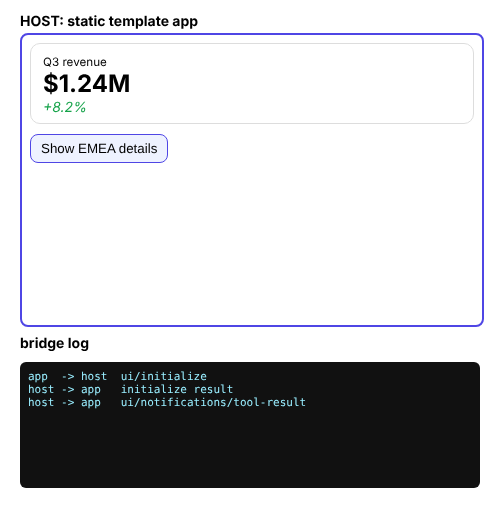
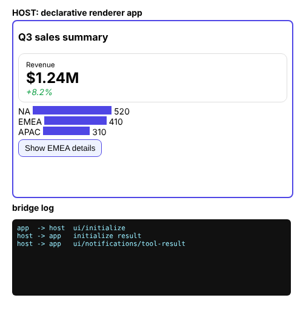
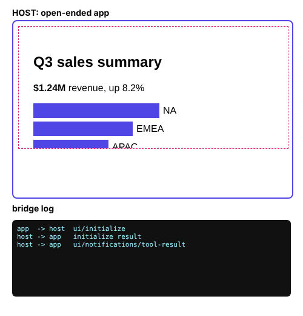
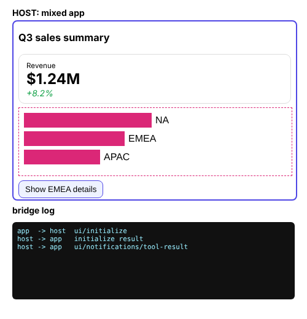

# Part 3 - MCP Apps

Reference: <https://modelcontextprotocol.io/extensions/apps/overview>

## The idea

MCP Apps: a tool declares `_meta.ui.resourceUri` (`ui://...`). A **third-party host** reads that HTML resource, mounts it in a sandboxed iframe and talks to it by JSON-RPC over `postMessage`. The host owns the policy.

All demos use the same scenario (a Q3 sales summary) and a **scripted model**, so they run offline and deterministically. Everything after the model call (parse, validate, render) is real and unchanged if you swap in a live model.

## Shared helpers for this part

- `mcp.py` - mini MCP server, `Host` with bridge policy, browser host page
- `apps.py` - the HTML apps shipped as `ui://` resources

## Static mode

*The app owns the UI. The model selects a pre-built component and supplies values.*

**What this part shows:** A fixed HTML template; the tool result only fills values.

### Code walkthrough - `part3_mcp_apps/static_mode.py`

```python
"""MCP Apps x STATIC. The ui:// resource is a fixed HTML template; the tool result only supplies values.
Run: python part3_mcp_apps/static_mode.py"""
import sys, pathlib; sys.path.insert(0, str(pathlib.Path(__file__).resolve().parents[1]))
from common.fixtures import STATIC_CALL
from part3_mcp_apps.apps import STATIC_APP
from part3_mcp_apps._common import build_server, run, banner

banner("MCP APPS / STATIC: fixed HTML template + tool result values")
server = build_server("static", lambda a: STATIC_CALL["arguments"], STATIC_APP)
run("static template app", server, "static")
```

### Run it

```bash
python part3_mcp_apps/static_mode.py
```

### Real output (captured by `run_all.sh`)

```text

======================================================================
MCP APPS / STATIC: fixed HTML template + tool result values
======================================================================

--- step 1: Host connects and lists tools (JSON-RPC: initialize, tools/list).
  show_sales             ui=ui://static/view.html  visibility=['model']
  show_region_details    ui=None  visibility=['app']
  the MODEL only sees: ['show_sales']  (app-only tools are hidden)

--- step 2: Model calls show_sales. Host sees resourceUri and fetches the ui:// resource.
  resource ui://static/view.html: 1529 chars of HTML (mime text/html;profile=mcp-app)
  structuredContent keys: ['label', 'value', 'delta']

--- step 3: Bridge policy. Requests from the iframe are checked by the HOST, not trusted.
  app asks ui/initialize                       -> OK
  app asks tools/call  show_region_details    -> OK
  app asks tools/call  show_sales             -> REFUSED: host refused: tool not callable by apps
  app asks tools/call  delete_database        -> REFUSED: host refused: tool not callable by apps

--- step 4: Render the host page in headless Chrome: iframe + live bridge log.
  screenshot -> out/part3_static.png
  server-side RPC log: ['initialize', 'tools/list', 'tools/call', 'resources/read', 'tools/call']
```



## Declarative mode

*The model describes the UI from a catalog of allowed components. The app validates, then renders.*

**What this part shows:** A generic renderer app; the tool result carries a validated spec.

### Code walkthrough - `part3_mcp_apps/declarative_mode.py`

```python
"""MCP Apps x DECLARATIVE. The tool returns a validated catalog spec; the app is a generic renderer.
The server validates BEFORE returning, so a bad model reply never reaches the host.
Run: python part3_mcp_apps/declarative_mode.py"""
import sys, pathlib; sys.path.insert(0, str(pathlib.Path(__file__).resolve().parents[1]))
from common.catalog import CATALOG, validate_spec
from common.fixtures import DECL_SPEC
from part3_mcp_apps.apps import RENDERER_APP
from part3_mcp_apps._common import build_server, run, banner

banner("MCP APPS / DECLARATIVE: spec in the tool result, generic renderer app")
def tool(_args):
    validate_spec(DECL_SPEC, CATALOG)       # server-side contract check
    return {"spec": DECL_SPEC}
run("declarative renderer app", build_server("decl", tool, RENDERER_APP), "declarative")
```

### Run it

```bash
python part3_mcp_apps/declarative_mode.py
```

### Real output (captured by `run_all.sh`)

```text

======================================================================
MCP APPS / DECLARATIVE: spec in the tool result, generic renderer app
======================================================================

--- step 1: Host connects and lists tools (JSON-RPC: initialize, tools/list).
  show_sales             ui=ui://decl/view.html  visibility=['model']
  show_region_details    ui=None  visibility=['app']
  the MODEL only sees: ['show_sales']  (app-only tools are hidden)

--- step 2: Model calls show_sales. Host sees resourceUri and fetches the ui:// resource.
  resource ui://decl/view.html: 2530 chars of HTML (mime text/html;profile=mcp-app)
  structuredContent keys: ['spec']

--- step 3: Bridge policy. Requests from the iframe are checked by the HOST, not trusted.
  app asks ui/initialize                       -> OK
  app asks tools/call  show_region_details    -> OK
  app asks tools/call  show_sales             -> REFUSED: host refused: tool not callable by apps
  app asks tools/call  delete_database        -> REFUSED: host refused: tool not callable by apps

--- step 4: Render the host page in headless Chrome: iframe + live bridge log.
  screenshot -> out/part3_declarative.png
  server-side RPC log: ['initialize', 'tools/list', 'tools/call', 'resources/read', 'tools/call']
```



## Open-ended mode

*The model writes markup. Anything goes, so it is linted and isolated in a sandboxed iframe.*

**What this part shows:** Model HTML runs in a NESTED sandbox: host iframe > app > nested iframe (two boundaries).

### Code walkthrough - `part3_mcp_apps/open_ended_mode.py`

```python
"""MCP Apps x OPEN-ENDED. The model's HTML travels in the tool result and is mounted in a NESTED sandbox,
two boundaries deep: host iframe > app > nested iframe. The server keeps any API key, never the iframe.
Run: python part3_mcp_apps/open_ended_mode.py"""
import sys, pathlib; sys.path.insert(0, str(pathlib.Path(__file__).resolve().parents[1]))
from common.fixtures import OPEN_HTML
from part3_mcp_apps.apps import RENDERER_APP
from part3_mcp_apps._common import build_server, run, banner

banner("MCP APPS / OPEN-ENDED: generated HTML in a nested sandbox")
spec = {"root": "art", "elements": {"art": {"type": "HtmlArtifact", "props": {"html": OPEN_HTML, "height": 200}}}}
server = build_server("open", lambda a: {"spec": spec}, RENDERER_APP)
run("open-ended app", server, "open_ended", check_html=lambda m: m["result"]["structuredContent"]["spec"]["elements"]["art"]["props"]["html"])
```

### Run it

```bash
python part3_mcp_apps/open_ended_mode.py
```

### Real output (captured by `run_all.sh`)

```text

======================================================================
MCP APPS / OPEN-ENDED: generated HTML in a nested sandbox
======================================================================

--- step 1: Host connects and lists tools (JSON-RPC: initialize, tools/list).
  show_sales             ui=ui://open/view.html  visibility=['model']
  show_region_details    ui=None  visibility=['app']
  the MODEL only sees: ['show_sales']  (app-only tools are hidden)

--- step 2: Model calls show_sales. Host sees resourceUri and fetches the ui:// resource.
  resource ui://open/view.html: 2530 chars of HTML (mime text/html;profile=mcp-app)
  structuredContent keys: ['spec']
  lint of model-generated part: clean

--- step 3: Bridge policy. Requests from the iframe are checked by the HOST, not trusted.
  app asks ui/initialize                       -> OK
  app asks tools/call  show_region_details    -> OK
  app asks tools/call  show_sales             -> REFUSED: host refused: tool not callable by apps
  app asks tools/call  delete_database        -> REFUSED: host refused: tool not callable by apps

--- step 4: Render the host page in headless Chrome: iframe + live bridge log.
  screenshot -> out/part3_open_ended.png
  server-side RPC log: ['initialize', 'tools/list', 'tools/call', 'resources/read', 'tools/call']
```



## Mixed mode

*Catalog components for the routine parts plus ONE sandboxed HtmlArtifact for a custom region.*

**What this part shows:** Catalog components plus a nested-sandbox region inside the host. Screenshot shows the live bridge log.

### Code walkthrough - `part3_mcp_apps/mixed_mode.py`

```python
"""MCP Apps x MIXED. Catalog components plus one HtmlArtifact, inside an MCP App. Static + open-ended together.
Run: python part3_mcp_apps/mixed_mode.py"""
import sys, pathlib; sys.path.insert(0, str(pathlib.Path(__file__).resolve().parents[1]))
from common.catalog import HYBRID_CATALOG, validate_spec
from common.fixtures import MIXED_SPEC
from part3_mcp_apps.apps import RENDERER_APP
from part3_mcp_apps._common import build_server, run, banner

banner("MCP APPS / MIXED: catalog + nested sandbox in a third-party host")
def tool(_a):
    validate_spec(MIXED_SPEC, HYBRID_CATALOG); return {"spec": MIXED_SPEC}
run("mixed app", build_server("mixed", tool, RENDERER_APP), "mixed",
    check_html=lambda m: m["result"]["structuredContent"]["spec"]["elements"]["chart"]["props"]["html"])
```

### Run it

```bash
python part3_mcp_apps/mixed_mode.py
```

### Real output (captured by `run_all.sh`)

```text

======================================================================
MCP APPS / MIXED: catalog + nested sandbox in a third-party host
======================================================================

--- step 1: Host connects and lists tools (JSON-RPC: initialize, tools/list).
  show_sales             ui=ui://mixed/view.html  visibility=['model']
  show_region_details    ui=None  visibility=['app']
  the MODEL only sees: ['show_sales']  (app-only tools are hidden)

--- step 2: Model calls show_sales. Host sees resourceUri and fetches the ui:// resource.
  resource ui://mixed/view.html: 2530 chars of HTML (mime text/html;profile=mcp-app)
  structuredContent keys: ['spec']
  lint of model-generated part: clean

--- step 3: Bridge policy. Requests from the iframe are checked by the HOST, not trusted.
  app asks ui/initialize                       -> OK
  app asks tools/call  show_region_details    -> OK
  app asks tools/call  show_sales             -> REFUSED: host refused: tool not callable by apps
  app asks tools/call  delete_database        -> REFUSED: host refused: tool not callable by apps

--- step 4: Render the host page in headless Chrome: iframe + live bridge log.
  screenshot -> out/part3_mixed.png
  server-side RPC log: ['initialize', 'tools/list', 'tools/call', 'resources/read', 'tools/call']
```


