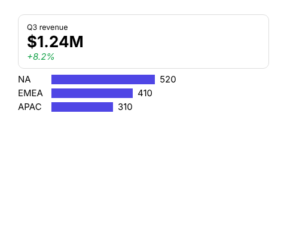
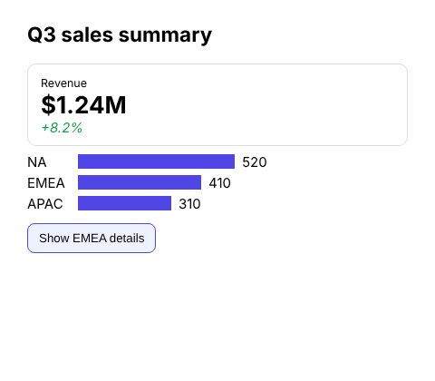
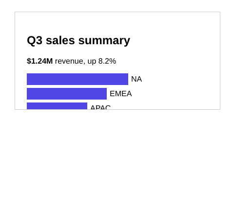
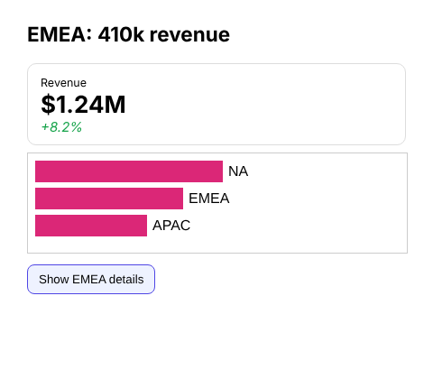

# Part 4 - json-render

Reference: <https://json-render.dev/>

## The idea

json-render: one **catalog** serves as prompt, validator and renderer registry. A flat element map streams as RFC 6902 patches, so the first paint happens early. The same spec renders to several targets.

All demos use the same scenario (a Q3 sales summary) and a **scripted model**, so they run offline and deterministically. Everything after the model call (parse, validate, render) is real and unchanged if you swap in a live model.

## Shared helpers for this part

- `jr.py` - patch ordering, `$state` binding, partial render, stream consumer

## Static mode

*The app owns the UI. The model selects a pre-built component and supplies values.*

**What this part shows:** App-owned spec with `$state` bindings; the model returns state only.

### Code walkthrough - `part4_json_render/static_mode.py`

```python
"""json-render x STATIC. The app owns the spec (with $state bindings). The model returns only STATE.
Run: python part4_json_render/static_mode.py"""
import sys, pathlib, json; sys.path.insert(0, str(pathlib.Path(__file__).resolve().parents[1]))
from common.catalog import CATALOG, validate_spec
from common.fixtures import SALES
from common.llm import ScriptedLLM
from common.render import render_text, save_page
from common.ui import banner, step, show
from part4_json_render.jr import resolve_state

banner("JSON-RENDER / STATIC: app-owned spec, model fills $state")
APP_SPEC = {"root": "page", "elements": {
    "page": {"type": "Stack", "props": {}, "children": ["kpi", "chart"]},
    "kpi": {"type": "Metric", "props": {"label": "Q3 revenue", "value": {"$state": "/revenue"}, "delta": {"$state": "/growth"}}},
    "chart": {"type": "BarChart", "props": {"data": {"$state": "/regions"}}}}}
step(1, "App spec with bindings (never model-written)"); show("spec", APP_SPEC)
step(2, "Model replies with state only"); state = json.loads(ScriptedLLM([SALES]).next()); show("state", state)
step(3, "Resolve bindings, validate, render")
spec = {**APP_SPEC, "elements": {k: resolve_state(v, state) for k, v in APP_SPEC["elements"].items()}}
validate_spec(spec, CATALOG); print(render_text(spec)); save_page(spec, "out/part4_static.html")
step(4, "Unbound state paths fail loudly (a model can't invent structure by inventing state)")
try: resolve_state(APP_SPEC["elements"]["kpi"], {"revenue": "x"})
except KeyError as e: print("  missing state key:", e)
```

### Run it

```bash
python part4_json_render/static_mode.py
```

### Real output (captured by `run_all.sh`)

```text

======================================================================
JSON-RENDER / STATIC: app-owned spec, model fills $state
======================================================================

--- step 1: App spec with bindings (never model-written)
spec:
    {
      "root": "page",
      "elements": {
        "page": {
          "type": "Stack",
          "props": {},
          "children": [
            "kpi",
            "chart"
          ]
        },
        "kpi": {
          "type": "Metric",
          "props": {
            "label": "Q3 revenue",
            "value": {
              "$state": "/revenue"
            },
            "delta": {
              "$state": "/growth"
            }
          }
        },
        "chart": {
          "type": "BarChart",
          "props": {
            "data": {
              "$state": "/regions"
            }
          }
        }
      }
    }

--- step 2: Model replies with state only
state:
    {
      "revenue": "$1.24M",
      "growth": "+8.2%",
      "regions": {
        "NA": 520,
        "EMEA": 410,
        "APAC": 310
      }
    }

--- step 3: Resolve bindings, validate, render
  [ Q3 revenue: $1.24M (+8.2%) ]
  NA   #################### 520
  EMEA ################ 410
  APAC ############ 310

--- step 4: Unbound state paths fail loudly (a model can't invent structure by inventing state)
  missing state key: 'growth'
```



## Declarative mode

*The model describes the UI from a catalog of allowed components. The app validates, then renders.*

**What this part shows:** Patch lines stream in; render after each; a bad element is rejected on arrival and the rest still render.

### Code walkthrough - `part4_json_render/declarative_mode.py`

```python
"""json-render x DECLARATIVE. Stream JSON Patch lines into the element map; render after every line.
Measures first paint (lines until something renders) vs complete, and rejects bad elements mid-stream.
Run: python part4_json_render/declarative_mode.py"""
import sys, pathlib, json, copy; sys.path.insert(0, str(pathlib.Path(__file__).resolve().parents[1]))
from common.catalog import CATALOG, catalog_prompt, validate_spec
from common.fixtures import DECL_SPEC, BAD_SPEC
from common.render import render_text, save_page
from common.ui import banner, step, show
from part4_json_render.jr import spec_to_patches, patches_to_jsonl, consume_stream, render_partial

banner("JSON-RENDER / DECLARATIVE: streaming patches into the element map")
step(1, "Prompt generated from the catalog"); print(catalog_prompt(CATALOG))

step(2, "Stream the spec as patch lines; render after each")
lines = patches_to_jsonl(spec_to_patches(DECL_SPEC)).splitlines()
for l in lines[:2]: print("  wire>", l[:110])
def on_step(n, spec, err):
    kinds = list(spec.get("elements", {}))
    print(f"  line {n}/{len(lines)}  elements={kinds}" + (f"   !! {err}" if err else ""))
    if n in (2, 3): print("\n".join("      | " + x for x in render_partial(spec, CATALOG).splitlines()))
spec, errors, fp = consume_stream(lines, CATALOG, on_step)
print(f"\n  first paint after line {fp} of {len(lines)} (a nested tree would need the full text)")
validate_spec(spec, CATALOG); print(render_text(spec))

step(3, "A bad element mid-stream is rejected on arrival; the rest still renders")
bad_lines = patches_to_jsonl(spec_to_patches(BAD_SPEC)).splitlines()
spec2, errors, _ = consume_stream(bad_lines, CATALOG, lambda *a: None)
print("  errors fed back to model:", errors)
print("  partial result:", list(spec2["elements"]))

step(4, "Two render targets, one spec"); print("  terminal: above; html ->", save_page(spec, "out/part4_declarative.html"))
```

### Run it

```bash
python part4_json_render/declarative_mode.py
```

### Real output (captured by `run_all.sh`)

```text

======================================================================
JSON-RENDER / DECLARATIVE: streaming patches into the element map
======================================================================

--- step 1: Prompt generated from the catalog
You may only use these components:
- Stack(none) +children: Vertical container.
- Heading(text:str): A section title.
- Metric(label:str, value:str, delta:str): One KPI with change.
- BarChart(data:dict): Bars from {label: number}.
- Button(label:str, action:str): Sends a NAMED action to the app.

--- step 2: Stream the spec as patch lines; render after each
  wire> {"op": "add", "path": "/root", "value": "page"}
  wire> {"op": "add", "path": "/elements/page", "value": {"type": "Stack", "props": {}, "children": ["title", "kpi", "
  line 1/6  elements=[]
  line 2/6  elements=['page']

  line 3/6  elements=['page', 'title']
      |   # Q3 sales summary
  line 4/6  elements=['page', 'title', 'kpi']
  line 5/6  elements=['page', 'title', 'kpi', 'chart']
  line 6/6  elements=['page', 'title', 'kpi', 'chart', 'more']

  first paint after line 2 of 6 (a nested tree would need the full text)
  # Q3 sales summary
  [ Revenue: $1.24M (+8.2%) ]
  NA   #################### 520
  EMEA ################ 410
  APAC ############ 310
  <Show EMEA details> -> action 'show_region:EMEA'

--- step 3: A bad element mid-stream is rejected on arrival; the rest still renders
  errors fed back to model: ["kpi: unknown component 'Gauge'. Allowed: ['BarChart', 'Button', 'Heading', 'Metric', 'Stack']"]
  partial result: ['page', 'title', 'chart', 'more']

--- step 4: Two render targets, one spec
  terminal: above; html -> out/part4_declarative.html
```



## Open-ended mode

*The model writes markup. Anything goes, so it is linted and isolated in a sandboxed iframe.*

**What this part shows:** One HtmlArtifact element carries markup; lint blocks the hostile reply.

### Code walkthrough - `part4_json_render/open_ended_mode.py`

```python
"""json-render x OPEN-ENDED. The catalog entry is a single HtmlArtifact; patches stream the markup.
Run: python part4_json_render/open_ended_mode.py"""
import sys, pathlib, json; sys.path.insert(0, str(pathlib.Path(__file__).resolve().parents[1]))
from common.catalog import HYBRID_CATALOG
from common.fixtures import OPEN_HTML, HOSTILE_HTML
from common.render import render_text, save_page
from common.ui import banner, step
from part4_json_render.jr import spec_to_patches, patches_to_jsonl, consume_stream
from common.sandbox import lint_html

banner("JSON-RENDER / OPEN-ENDED: one HtmlArtifact element, linted then sandboxed")
for i, (name, markup) in enumerate((("friendly", OPEN_HTML), ("hostile", HOSTILE_HTML)), 1):
    step(i, f"{name} model output")
    spec = {"root": "art", "elements": {"art": {"type": "HtmlArtifact", "props": {"html": markup, "height": 200}}}}
    result, errs, fp = consume_stream(patches_to_jsonl(spec_to_patches(spec)).splitlines(), HYBRID_CATALOG, lambda *a: None)
    findings = lint_html(markup)
    print("  schema errors:", errs or "none", "| lint:", findings or "clean")
    if findings: print("  -> not rendered; findings returned to the model"); continue
    print(render_text(result)); save_page(result, "out/part4_open_ended.html")
```

### Run it

```bash
python part4_json_render/open_ended_mode.py
```

### Real output (captured by `run_all.sh`)

```text

======================================================================
JSON-RENDER / OPEN-ENDED: one HtmlArtifact element, linted then sandboxed
======================================================================

--- step 1: friendly model output
  schema errors: none | lint: clean
[sandboxed HTML, 549 chars]

--- step 2: hostile model output
  schema errors: none | lint: ['external <script src>', 'network call', 'storage/cookie access', '<form> (can post data out)', 'external URL']
  -> not rendered; findings returned to the model
```



## Mixed mode

*Catalog components for the routine parts plus ONE sandboxed HtmlArtifact for a custom region.*

**What this part shows:** Catalog + artifact, an action handler returning a patch, and an unregistered action that is inert.

### Code walkthrough - `part4_json_render/mixed_mode.py`

```python
"""json-render x MIXED. Catalog + HtmlArtifact, actions that round-trip, and a terminal target.
Run: python part4_json_render/mixed_mode.py"""
import sys, pathlib, json; sys.path.insert(0, str(pathlib.Path(__file__).resolve().parents[1]))
from common.catalog import HYBRID_CATALOG
from common.fixtures import MIXED_SPEC, SALES
from common.jsonpatch import apply_patch
from common.render import render_text, save_page
from common.sandbox import ALLOWED_ACTIONS
from common.ui import banner, step, show
from part4_json_render.jr import spec_to_patches, patches_to_jsonl, consume_stream

banner("JSON-RENDER / MIXED: catalog + sandboxed region + named actions")
step(1, "Stream the mixed spec")
spec, errs, fp = consume_stream(patches_to_jsonl(spec_to_patches(MIXED_SPEC)).splitlines(), HYBRID_CATALOG, lambda *a: None)
print(f"  errors={errs or 'none'}  first paint at line {fp}"); print(render_text(spec))

def handle_action(spec, action):
    """Actions are NAMED handlers. The spec can say 'show_region:EMEA'; only registered handlers run."""
    name, _, arg = action.partition(":")
    if name not in ALLOWED_ACTIONS: raise PermissionError(f"no handler registered for '{name}'")
    patch = [{"op": "replace", "path": "/elements/title/props/text", "value": f"{arg}: {SALES['regions'][arg]}k revenue"}]
    show("handler returns a patch", patch); return apply_patch(spec, patch)

step(2, "User clicks the button -> its action string"); spec = handle_action(spec, MIXED_SPEC["elements"]["more"]["props"]["action"])
print(render_text(spec))
step(3, "A spec that names an unregistered action is inert")
try: handle_action(spec, "drop_table:users")
except PermissionError as e: print("  DENIED:", e)
save_page(spec, "out/part4_mixed.html")
```

### Run it

```bash
python part4_json_render/mixed_mode.py
```

### Real output (captured by `run_all.sh`)

```text

======================================================================
JSON-RENDER / MIXED: catalog + sandboxed region + named actions
======================================================================

--- step 1: Stream the mixed spec
  errors=none  first paint at line 2
  # Q3 sales summary
  [ Revenue: $1.24M (+8.2%) ]
  [sandboxed HTML, 339 chars]
  <Show EMEA details> -> action 'show_region:EMEA'

--- step 2: User clicks the button -> its action string
handler returns a patch:
    [
      {
        "op": "replace",
        "path": "/elements/title/props/text",
        "value": "EMEA: 410k revenue"
      }
    ]
  # EMEA: 410k revenue
  [ Revenue: $1.24M (+8.2%) ]
  [sandboxed HTML, 339 chars]
  <Show EMEA details> -> action 'show_region:EMEA'

--- step 3: A spec that names an unregistered action is inert
  DENIED: no handler registered for 'drop_table'
```


