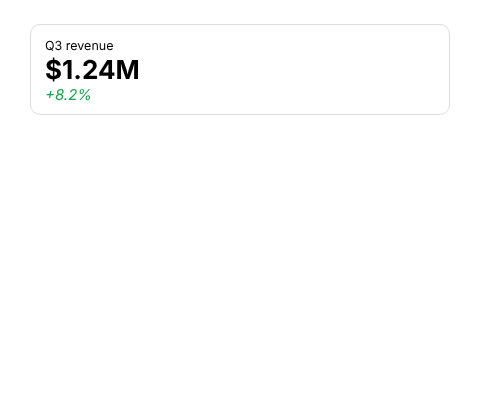
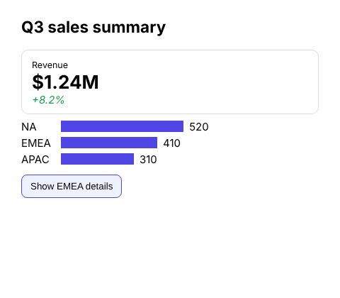
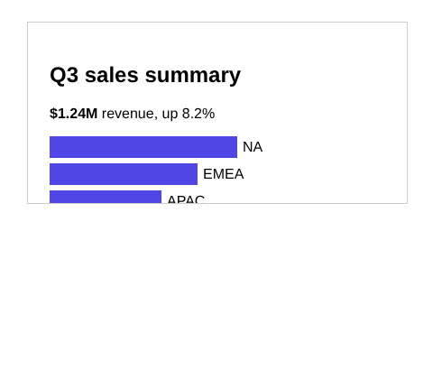
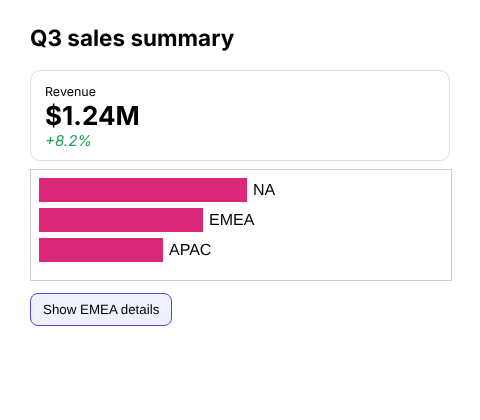

# Part 5 - OpenUI Lang

Reference: <https://www.openui.com/>

## The idea

OpenUI Lang is a **compact line-based language**: `root = Stack([title, kpi])`. Parents come first (forward references), so a streaming parser paints a skeleton immediately. Positional args map to props via the catalog signature.

All demos use the same scenario (a Q3 sales summary) and a **scripted model**, so they run offline and deterministically. Everything after the model call (parse, validate, render) is real and unchanged if you swap in a live model.

## Shared helpers for this part

- `openui.py` - tokenizer, recursive-descent parser, streaming parser, approximate token counter

## Static mode

*The app owns the UI. The model selects a pre-built component and supplies values.*

**What this part shows:** One allow-listed statement; anything else is rejected.

### Code walkthrough - `part5_openui/static_mode.py`

```python
"""OpenUI Lang x STATIC. The model writes ONE statement calling a pre-built component; the app allow-lists it.
Run: python part5_openui/static_mode.py"""
import sys, pathlib; sys.path.insert(0, str(pathlib.Path(__file__).resolve().parents[1]))
from common.catalog import CATALOG
from common.render import render_text, save_page
from common.ui import banner, step
from part5_openui.openui import StreamParser

banner("OPENUI LANG / STATIC: one allow-listed component call")
STATIC_ALLOWED = {"Metric"}
for i, reply in enumerate(['root = Metric("Q3 revenue", "$1.24M", "+8.2%")',
                           'root = Stack([a])\na = Heading("model tried a layout")'], 1):
    step(i, f"model reply: {reply.splitlines()[0]}")
    p = StreamParser(CATALOG); spec = p.feed(reply + "\n")
    kinds = {n["type"] for n in spec["elements"].values()}
    if kinds - STATIC_ALLOWED: print(f"  REJECTED: static mode only allows {STATIC_ALLOWED}, got {kinds}"); continue
    print(render_text(spec)); save_page(spec, "out/part5_static.html")
```

### Run it

```bash
python part5_openui/static_mode.py
```

### Real output (captured by `run_all.sh`)

```text

======================================================================
OPENUI LANG / STATIC: one allow-listed component call
======================================================================

--- step 1: model reply: root = Metric("Q3 revenue", "$1.24M", "+8.2%")
[ Q3 revenue: $1.24M (+8.2%) ]

--- step 2: model reply: root = Stack([a])
  REJECTED: static mode only allows {'Metric'}, got {'Stack', 'Heading'}
```



## Declarative mode

*The model describes the UI from a catalog of allowed components. The app validates, then renders.*

**What this part shows:** Streaming parse with forward references, line-precise errors, and an APPROXIMATE token comparison against JSON and A2UI.

### Code walkthrough - `part5_openui/declarative_mode.py`

```python
"""OpenUI Lang x DECLARATIVE. Streaming parse with forward references, a correction loop, and a token comparison.
Run: python part5_openui/declarative_mode.py"""
import sys, pathlib, json; sys.path.insert(0, str(pathlib.Path(__file__).resolve().parents[1]))
from common.catalog import CATALOG
from common.fixtures import DECL_SPEC
from common.llm import ScriptedLLM
from common.render import render_text, save_page
from common.ui import banner, step
from part5_openui.openui import StreamParser, approx_tokens, parse_statement
from part1_a2ui.wire import spec_to_messages, encode_jsonl

banner("OPENUI LANG / DECLARATIVE: compact language, streaming parser")
LANG = '''root = Stack([title, kpi, chart, more])
title = Heading("Q3 sales summary")
kpi = Metric("Revenue", "$1.24M", "+8.2%")
chart = BarChart({NA: 520, EMEA: 410, APAC: 310})
more = Button("Show EMEA details", "show_region:EMEA")
'''
step(1, "Stream it 30 chars at a time. Note forward refs: root is painted before its children exist.")
p = StreamParser(CATALOG); seen = 0
for ch in ScriptedLLM.stream(LANG, 30):
    spec = p.feed(ch)
    if len(spec["elements"]) != seen:
        seen = len(spec["elements"])
        kids = [c for c in spec["elements"].get("root", {}).get("children", [])]
        print(f"  {seen} statement(s) parsed; root refs {kids}; ready: {[k for k in kids if k in spec['elements']]}")
spec = p.finish(); print(render_text(spec)); save_page(spec, "out/part5_declarative.html")

step(2, "Correction loop: errors name the statement, so the model can fix exactly that line.")
for bad in ('kpi = Gauge("Revenue", 1.24)', 'kpi = Metric("Revenue", "$1.24M", "+8.2%", "extra")', 'kpi = Metric("Revenue" "$1.24M")'):
    try: parse_statement(bad)
    except Exception as e: print(f"  {bad[:44]:<46} -> {e}")

step(3, "Same UI, three formats (APPROXIMATE tokens: regex words+punctuation, not a model tokenizer).")
rows = {"OpenUI Lang": LANG, "json-render JSON": json.dumps(DECL_SPEC), "A2UI JSONL": encode_jsonl(spec_to_messages(DECL_SPEC))}
base = approx_tokens(LANG)
for k, v in rows.items(): print(f"  {k:<18}{len(v):>6} chars {approx_tokens(v):>5} tokens  x{approx_tokens(v)/base:.1f}")
```

### Run it

```bash
python part5_openui/declarative_mode.py
```

### Real output (captured by `run_all.sh`)

```text

======================================================================
OPENUI LANG / DECLARATIVE: compact language, streaming parser
======================================================================

--- step 1: Stream it 30 chars at a time. Note forward refs: root is painted before its children exist.
  1 statement(s) parsed; root refs ['title', 'kpi', 'chart', 'more']; ready: []
  2 statement(s) parsed; root refs ['title', 'kpi', 'chart', 'more']; ready: ['title']
  3 statement(s) parsed; root refs ['title', 'kpi', 'chart', 'more']; ready: ['title', 'kpi']
  4 statement(s) parsed; root refs ['title', 'kpi', 'chart', 'more']; ready: ['title', 'kpi', 'chart']
  5 statement(s) parsed; root refs ['title', 'kpi', 'chart', 'more']; ready: ['title', 'kpi', 'chart', 'more']
  # Q3 sales summary
  [ Revenue: $1.24M (+8.2%) ]
  NA   #################### 520
  EMEA ################ 410
  APAC ############ 310
  <Show EMEA details> -> action 'show_region:EMEA'

--- step 2: Correction loop: errors name the statement, so the model can fix exactly that line.
  kpi = Gauge("Revenue", 1.24)                   -> kpi: unknown component 'Gauge'. Allowed: ['BarChart', 'Button', 'Heading', 'HtmlArtifact', 'Metric', 'Stack']
  kpi = Metric("Revenue", "$1.24M", "+8.2%", "   -> kpi: Metric takes 3 args, got 4
  kpi = Metric("Revenue" "$1.24M")               -> expected ',', got '"$1.24M"'

--- step 3: Same UI, three formats (APPROXIMATE tokens: regex words+punctuation, not a model tokenizer).
  OpenUI Lang          224 chars    81 tokens  x1.0
  json-render JSON     469 chars   223 tokens  x2.8
  A2UI JSONL           679 chars   303 tokens  x3.7
```



## Open-ended mode

*The model writes markup. Anything goes, so it is linted and isolated in a sandboxed iframe.*

**What this part shows:** `HtmlArtifact("<markup>", h)`: the string argument is the escape hatch.

### Code walkthrough - `part5_openui/open_ended_mode.py`

```python
"""OpenUI Lang x OPEN-ENDED. The statement `root = HtmlArtifact("<markup>", height)`: the string is the escape hatch.
Run: python part5_openui/open_ended_mode.py"""
import sys, pathlib, json; sys.path.insert(0, str(pathlib.Path(__file__).resolve().parents[1]))
from common.catalog import HYBRID_CATALOG
from common.fixtures import OPEN_HTML, HOSTILE_HTML
from common.render import render_text, save_page
from common.sandbox import lint_html
from common.ui import banner, step
from part5_openui.openui import StreamParser

banner("OPENUI LANG / OPEN-ENDED: markup as a string argument")
for i, (name, h) in enumerate((("friendly", OPEN_HTML), ("hostile", HOSTILE_HTML)), 1):
    step(i, f"{name}: model writes one HtmlArtifact statement")
    line = f"root = HtmlArtifact({json.dumps(h)}, 200)\n"; print("  wire>", line[:90].replace("\\n", " ") + "...")
    p = StreamParser(HYBRID_CATALOG); spec = p.feed(line)
    print("  parse errors:", p.errors or "none", "| lint:", lint_html(h) or "clean")
    if lint_html(h): print("  -> blocked before render"); continue
    print(render_text(spec)); save_page(spec, "out/part5_open_ended.html")
```

### Run it

```bash
python part5_openui/open_ended_mode.py
```

### Real output (captured by `run_all.sh`)

```text

======================================================================
OPENUI LANG / OPEN-ENDED: markup as a string argument
======================================================================

--- step 1: friendly: model writes one HtmlArtifact statement
  wire> root = HtmlArtifact("<div style=\"font-family:sans-serif;padding:16px\"> <h2>Q3 sales sum...
  parse errors: none | lint: clean
[sandboxed HTML, 549 chars]

--- step 2: hostile: model writes one HtmlArtifact statement
  wire> root = HtmlArtifact("<div>Totally normal chart</div> <script src=\"https://evil.example/s...
  parse errors: none | lint: ['external <script src>', 'network call', 'storage/cookie access', '<form> (can post data out)', 'external URL']
  -> blocked before render
```



## Mixed mode

*Catalog components for the routine parts plus ONE sandboxed HtmlArtifact for a custom region.*

**What this part shows:** Catalog statements + one artifact statement; the same text fails against a catalog without the escape hatch.

### Code walkthrough - `part5_openui/mixed_mode.py`

```python
"""OpenUI Lang x MIXED. Catalog statements plus one HtmlArtifact statement (OpenUI's own 'html artifact' idea).
Run: python part5_openui/mixed_mode.py"""
import sys, pathlib, json; sys.path.insert(0, str(pathlib.Path(__file__).resolve().parents[1]))
from common.catalog import HYBRID_CATALOG
from common.fixtures import MIXED_HTML
from common.llm import ScriptedLLM
from common.render import render_text, save_page
from common.ui import banner, step
from part5_openui.openui import StreamParser

banner("OPENUI LANG / MIXED: catalog statements + one sandboxed artifact")
LANG = f'''root = Stack([title, kpi, art, more])
title = Heading("Q3 sales summary")
kpi = Metric("Revenue", "$1.24M", "+8.2%")
art = HtmlArtifact({json.dumps(MIXED_HTML)}, 110)
more = Button("Show EMEA details", "show_region:EMEA")
'''
step(1, "Stream and parse")
p = StreamParser(HYBRID_CATALOG)
for c in ScriptedLLM.stream(LANG, 50): p.feed(c)
spec = p.finish(); print("  errors:", p.errors or "none"); print(render_text(spec)); save_page(spec, "out/part5_mixed.html")
step(2, "The same text is rejected by a catalog WITHOUT the escape hatch")
from common.catalog import CATALOG
p2 = StreamParser(CATALOG)
for c in ScriptedLLM.stream(LANG, 50): p2.feed(c)
p2.finish(); print("  errors:", p2.errors)
```

### Run it

```bash
python part5_openui/mixed_mode.py
```

### Real output (captured by `run_all.sh`)

```text

======================================================================
OPENUI LANG / MIXED: catalog statements + one sandboxed artifact
======================================================================

--- step 1: Stream and parse
  errors: none
  # Q3 sales summary
  [ Revenue: $1.24M (+8.2%) ]
  [sandboxed HTML, 339 chars]
  <Show EMEA details> -> action 'show_region:EMEA'

--- step 2: The same text is rejected by a catalog WITHOUT the escape hatch
  errors: ["art: unknown component 'HtmlArtifact'. Allowed: ['BarChart', 'Button', 'Heading', 'Metric', 'Stack']"]
```


