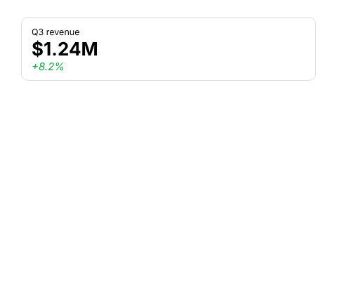
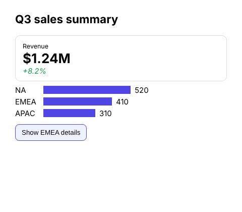
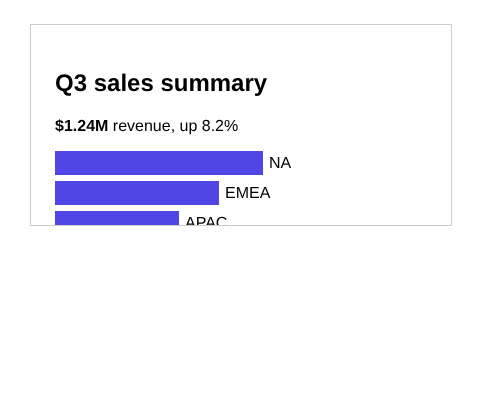
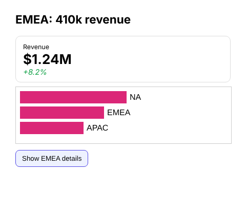

# Part 6 - Harness integration

Reference: <https://github.com/dlmastery/simple-coding-harness/tree/main/genui>

## The idea

A harness is the agent loop: model -> tool call -> tool result -> model. GenUI joins as **tools**. UI validation errors are tool results (the model retries), one UI event feeds two surfaces (terminal and web), and UI actions pass a permission gate.

All demos use the same scenario (a Q3 sales summary) and a **scripted model**, so they run offline and deterministically. Everything after the model call (parse, validate, render) is real and unchanged if you swap in a live model.

## Shared helpers for this part

- `harness.py` - the loop, `render_ui` / `render_html` / `show_metric` tools, the action gate

## Static mode

*The app owns the UI. The model selects a pre-built component and supplies values.*

**What this part shows:** Preset `show_metric` tool.

### Code walkthrough - `part6_harness/static_mode.py`

```python
"""Harness x STATIC. The model calls a preset tool (show_metric); the harness draws on two surfaces.
Run: python part6_harness/static_mode.py"""
import sys, pathlib; sys.path.insert(0, str(pathlib.Path(__file__).resolve().parents[1]))
from part6_harness._demo import *
from common.catalog import CATALOG
from common.fixtures import STATIC_CALL
banner("HARNESS / STATIC: preset UI tool in the agent loop")
h = Harness(ScriptedModel([{"tool": "get_sales_data"}, {"tool": "show_metric", "args": STATIC_CALL["arguments"]},
                           {"text": "Q3 revenue is $1.24M, up 8.2%."}]), CATALOG, "out/part6_static.html")
step(1, "Run the agent loop"); h.run("Give me a Q3 sales summary")
```

### Run it

```bash
python part6_harness/static_mode.py
```

### Real output (captured by `run_all.sh`)

```text

======================================================================
HARNESS / STATIC: preset UI tool in the agent loop
======================================================================

--- step 1: Run the agent loop
turn 1: tool call get_sales_data()
         result -> <data>
turn 2: tool call show_metric(label, value, delta)
  [terminal surface]
    [ Q3 revenue: $1.24M (+8.2%) ]
  [web surface] wrote out/part6_static.html
         result -> ok: rendered on terminal and web surfaces
turn 3: model says: Q3 revenue is $1.24M, up 8.2%.
```



## Declarative mode

*The model describes the UI from a catalog of allowed components. The app validates, then renders.*

**What this part shows:** `render_ui` rejects a bad spec; the error returns as a tool result; the model corrects itself.

### Code walkthrough - `part6_harness/declarative_mode.py`

```python
"""Harness x DECLARATIVE. render_ui validates against the catalog; the first attempt is wrong, the error comes
back as a TOOL RESULT, and the model self-corrects on the next turn.
Run: python part6_harness/declarative_mode.py"""
import sys, pathlib; sys.path.insert(0, str(pathlib.Path(__file__).resolve().parents[1]))
from part6_harness._demo import *
from common.catalog import CATALOG
from common.fixtures import DECL_SPEC, BAD_SPEC
banner("HARNESS / DECLARATIVE: validated render_ui with a self-correction turn")
h = Harness(ScriptedModel([{"tool": "get_sales_data"}, {"tool": "render_ui", "args": {"spec": BAD_SPEC}},
                           {"tool": "render_ui", "args": {"spec": DECL_SPEC}}, {"text": "Dashboard shown."}]),
            CATALOG, "out/part6_declarative.html")
step(1, "Run the agent loop"); h.run("Give me a Q3 sales summary")
```

### Run it

```bash
python part6_harness/declarative_mode.py
```

### Real output (captured by `run_all.sh`)

```text

======================================================================
HARNESS / DECLARATIVE: validated render_ui with a self-correction turn
======================================================================

--- step 1: Run the agent loop
turn 1: tool call get_sales_data()
         result -> <data>
turn 2: tool call render_ui(spec)
         result -> ERROR: kpi: unknown component 'Gauge'. Allowed: ['BarChart', 'Button', 'Heading', 'Metric', 'Stack']
turn 3: tool call render_ui(spec)
  [terminal surface]
      # Q3 sales summary
      [ Revenue: $1.24M (+8.2%) ]
      NA   #################### 520
      EMEA ################ 410
      APAC ############ 310
      <Show EMEA details> -> action 'show_region:EMEA'
  [web surface] wrote out/part6_declarative.html
         result -> ok: rendered on terminal and web surfaces
turn 4: model says: Dashboard shown.
```



## Open-ended mode

*The model writes markup. Anything goes, so it is linted and isolated in a sandboxed iframe.*

**What this part shows:** `render_html` rejects hostile markup, then accepts the clean retry.

### Code walkthrough - `part6_harness/open_ended_mode.py`

```python
"""Harness x OPEN-ENDED. render_html lints markup. A hostile attempt is rejected as a tool result; the model retries.
Run: python part6_harness/open_ended_mode.py"""
import sys, pathlib; sys.path.insert(0, str(pathlib.Path(__file__).resolve().parents[1]))
from part6_harness._demo import *
from common.catalog import CATALOG
from common.fixtures import OPEN_HTML, HOSTILE_HTML
banner("HARNESS / OPEN-ENDED: render_html with lint + sandbox")
h = Harness(ScriptedModel([{"tool": "render_html", "args": {"html": HOSTILE_HTML}},
                           {"tool": "render_html", "args": {"html": OPEN_HTML}}, {"text": "Custom chart shown."}]),
            CATALOG, "out/part6_open_ended.html")
step(1, "Run the agent loop"); h.run("Draw me something custom for Q3 sales")
```

### Run it

```bash
python part6_harness/open_ended_mode.py
```

### Real output (captured by `run_all.sh`)

```text

======================================================================
HARNESS / OPEN-ENDED: render_html with lint + sandbox
======================================================================

--- step 1: Run the agent loop
turn 1: tool call render_html(html)
         result -> ERROR: html rejected: ['external <script src>', 'network call', 'storage/cookie access', '<form> (can post dat
turn 2: tool call render_html(html)
  [terminal surface]
    [sandboxed HTML, 549 chars]
  [web surface] wrote out/part6_open_ended.html
         result -> ok: rendered on terminal and web surfaces
turn 3: model says: Custom chart shown.
```



## Mixed mode

*Catalog components for the routine parts plus ONE sandboxed HtmlArtifact for a custom region.*

**What this part shows:** Hybrid spec, then an allowed click and a denied click through the permission gate.

### Code walkthrough - `part6_harness/mixed_mode.py`

```python
"""Harness x MIXED. Catalog + HtmlArtifact spec, then the full action loop with a permission gate.
Run: python part6_harness/mixed_mode.py"""
import sys, pathlib; sys.path.insert(0, str(pathlib.Path(__file__).resolve().parents[1]))
from part6_harness._demo import *
from common.catalog import HYBRID_CATALOG
from common.fixtures import MIXED_SPEC
import copy
banner("HARNESS / MIXED: hybrid surface + action permission gate")
h = Harness(ScriptedModel([{"tool": "get_sales_data"}, {"tool": "render_ui", "args": {"spec": copy.deepcopy(MIXED_SPEC)}},
                           {"text": "Hybrid dashboard shown."}]), HYBRID_CATALOG, "out/part6_mixed.html")
step(1, "Run the agent loop"); h.run("Give me a Q3 sales summary with a custom chart")
step(2, "User clicks a button defined in the spec"); h.on_ui_action("show_region:EMEA")
step(3, "A spec can name any action string. The gate, not the spec, grants permission"); h.on_ui_action("export_customer_table:all")
```

### Run it

```bash
python part6_harness/mixed_mode.py
```

### Real output (captured by `run_all.sh`)

```text

======================================================================
HARNESS / MIXED: hybrid surface + action permission gate
======================================================================

--- step 1: Run the agent loop
turn 1: tool call get_sales_data()
         result -> <data>
turn 2: tool call render_ui(spec)
  [terminal surface]
      # Q3 sales summary
      [ Revenue: $1.24M (+8.2%) ]
      [sandboxed HTML, 339 chars]
      <Show EMEA details> -> action 'show_region:EMEA'
  [web surface] wrote out/part6_mixed.html
         result -> ok: rendered on terminal and web surfaces
turn 3: model says: Hybrid dashboard shown.

--- step 2: User clicks a button defined in the spec
  action 'show_region' allowed -> state updated, re-render:
  [terminal surface]
      # EMEA: 410k revenue
      [ Revenue: $1.24M (+8.2%) ]
      [sandboxed HTML, 339 chars]
      <Show EMEA details> -> action 'show_region:EMEA'
  [web surface] wrote out/part6_mixed.html

--- step 3: A spec can name any action string. The gate, not the spec, grants permission
  action 'export_customer_table' DENIED by permission gate
```


