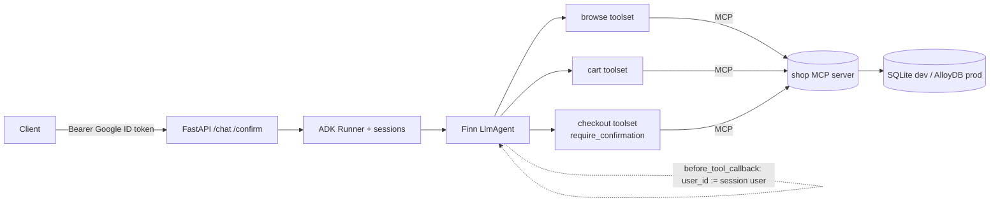

# (e) Production-quality E-commerce agent ("Finn")

Browse → cart → pay, with identity binding and human-approved checkout.



## Why it's production-minded
| Concern | Mechanism | Tested |
|---|---|---|
| AuthN | Google ID-token verification (`GOOGLE_CLIENT_ID`); dev header only if `ALLOW_DEV_AUTH=1` | 401 without auth |
| Prompt-injection / IDOR | `enforce_identity` overwrites `user_id` on every user-scoped tool call | model says `victim`, cart goes to the signed-in user |
| Payments | `checkout` behind ADK confirmation; API returns `pending_confirmation`, client calls `/confirm` | nothing charged before approval; reject keeps cart |
| Overselling | guarded `UPDATE … WHERE stock>=qty` inside `BEGIN IMMEDIATE`, rollback on failure | race test |
| Money | integer cents, euros only formatted at the edge | totals |
| Privacy | other users' orders/sessions return "not found" | yes |
| Persistence | `SESSION_DB_URL` → `DatabaseSessionService` | not run here |

## Run
```bash
pip install -r requirements.txt && cp .env.example .env && export PYTHONPATH=$PWD
ALLOW_DEV_AUTH=1 uvicorn --factory ecommerce_agent.app:get_app --port 8080
curl -s localhost:8080/chat -H 'X-User-Id: alice' -H 'content-type: application/json' -d '{"message":"show me Nike running shoes under 150"}'
```
Or `adk web` for the dev UI (set `user_id` in session state for cart tools).

## AlloyDB + MCP Toolbox variant (from the codelab you referenced)
`toolbox/tools.yaml` + `toolbox/schema_alloydb.sql` show how the read tools map onto AlloyDB via MCP Toolbox for Databases; point `MCP_SHOP_URL` at it. **These two files were not executed** (no AlloyDB instance available while building) — the SQLite MCP server is the verified path. The React storefront from the reference repo is out of scope; the API above is what a UI would call.
